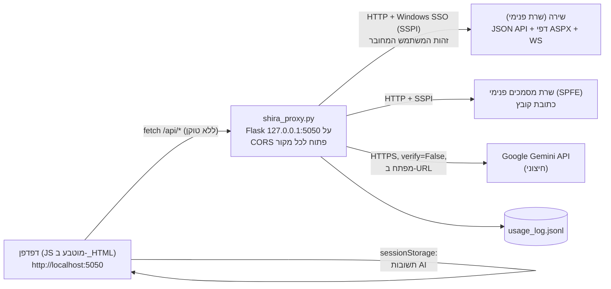

# PROJECT_AUDIT_CONTEXT.md — SHIRA-AI (`shira_proxy.py`)

> מסמך הקשר לביקורת מקצועית, טכנית ואבטחתית, המבוסס על קריאה בפועל של הקוד.
> **היקף:** רק `shira_proxy.py` (2,118 שורות) ו-`START.bat` מתוך המאגר `eys2005-afk/SHIRA-AI` (קומיט `6a4cd89`).
> התיקייה `hearing-agent/` (סוכן יומן דיונים ו-Verbit) הוצאה מההיקף לבקשת המשתמש ולא נסקרה במסמך זה.
> לא שונה שום קובץ בפרויקט, לא בוצעו בדיקות חדירה, ולא נעשו פניות למערכות חיצוניות (לא לשירה ולא ל-Gemini).
> המסמך אינו כולל סיסמאות, מפתחות, כתובות IP, פרטי תיקים או מידע אישי. ערכים רגישים מצוינים לפי מיקום (שורה) בלבד.

**מקרא:** ✅ אומת בקוד · 🟡 השערה / לא ניתן לאמת מהמאגר · ❌ לא נמצא

---

## 0. הערות מקדימות ל-GPT-6

1. ✅ זהו אכן פרויקט של בתי הדין הרבניים (`shira_proxy.py:199`, `:1992-1993`, `:1780`).
2. ✅ המאגר כולל רק שני קבצים מחוץ ל-`hearing-agent/`: `shira_proxy.py` ו-`START.bat`. אין `requirements.txt` בשורש, אין `.gitignore` בשורש, אין README בשורש, אין בדיקות.
3. ✅ ה-"AI" בפרויקט הוא **Google Gemini 2.5 Flash** ולא Claude (`:1755`, `:1796-1797`).
4. 🟡 ההיסטוריה שנבדקה: 14 קומיטים, מהם 3 שנוגעים ל-`shira_proxy.py` (`5b91f97`, `ea11fba`, `5a06f95`). הקבצים של `hearing-agent` הוצאו מההיקף.
5. 🟡 **"שירה" (מערכת ניהול התיקים) ו-"ספרא"**: הקוד ניגש רק לשירה. ❌ אין שום התייחסות לספרא (חיפוש טקסט).
6. ✅ מתודה: קראתי במלואם שורות 1-400 (HTML/CSS/JS ראשוני) ו-1398-2118 (כל ה-backend). את ה-JavaScript המוטבע (401-1397) סרקתי בחיפושים ממוקדים (innerHTML, fetch, storage, פונקציות) וקראתי את הקטעים של `askAI` ו-`streamAI`; לא קראתי כל שורה שלו. נדרשת קריאה מלאה של אזור זה לביקורת סופית.

---

## 1. מטרת הפרויקט

✅ ממשק חיפוש חכם וסיכומי AI מעל מערכת "שירה" (ניהול תיקים של בתי הדין הרבניים), המופעל מקומית אצל המשתמש (`:198-199`, כותרת "חיפוש חכם וסיכומי AI").

**משתמשים:** עובדי בית דין (דיינים, מזכירות, מנהלי תיקים). ✅ זיהוי בית הדין והמשתמש נעשה אוטומטית מ-Windows SSO (`:1431-1466`). 🟡 מספר המשתמשים וההפצה (EXE? ראה `:56`) אינם ידועים.

**פעולות שהמערכת מייעלת:**
1. חיפוש תיקים לפי ת"ז, מספר תיק או שם (`:1469-1559`).
2. הצגת מסמכי תיק ודיונים (`:1601`, `:1676`).
3. חילוץ טקסט ממסמכי PDF/Word (`:1640-1673`) וחיפוש בתוכן המסמכים, בתיק אחד או בכל תיקי הצדדים (JS: `doContentSearch*`, `doSearchAllCases`).
4. שאלות ותשובות וסיכומים באמצעות Gemini על בסיס מסמכי התיק (`:1772-1912`).
5. ייצוא סיכום AI למסמך Word בעיצוב בית הדין (`:1915-2058`).
6. מעקב עלויות AI (`:1846-1893`, `:2061-2094`).

---

## 2. ארכיטקטורה

### 2.1 טכנולוגיות (✅ מתוך הקוד; אין requirements.txt)
| רכיב | פרט |
|---|---|
| שרת | Python, Flask, flask-cors (`:44-45`) |
| הזדהות מול שירה | `requests` + `requests_negotiate_sspi.HttpNegotiateAuth` (Kerberos/NTLM, Windows בלבד) (`:47`, `:1415`) |
| פענוח HTML | BeautifulSoup + lxml (`:48`, `:1568`) |
| מסמכים | pdfplumber, python-docx (`:49-50`) |
| AI | Google Gemini 2.5 Flash (REST, streaming SSE) |
| לקוח | HTML, CSS ו-JavaScript טהור מוטבעים כמחרוזת Python (`_HTML`, שורות 58-1400); ללא framework וללא build |
| הפעלה | `START.bat` מריץ `python "C:\SHIRA AI\shira_proxy.py"` (נתיב קשיח). `:56` מזכיר EXE עצמאי, ❌ ללא סקריפט בנייה במאגר |

### 2.2 מסד נתונים
❌ אין מסד נתונים. אחסון:
- לוג שימוש AI: `usage_log.jsonl` לצד הקוד (`:1886`) (טוקנים ועלות בלבד, ללא תוכן). ✅
- טקסטי מסמכים ותשובות AI נשמרים ב-`sessionStorage` של הדפדפן (`:1257`) ובזיכרון JS (`docTexts`). ✅

### 2.3 נקודות קצה (✅)
| נתיב | שורה | תפקיד |
|---|---|---|
| `GET /` | 1427 | מגיש את ה-HTML המוטבע |
| `GET /api/me` | 1431 | זהות משתמש ובית דין משירה |
| `POST /api/search` | 1469 | חיפוש לפי ת"ז |
| `POST /api/search-case` | 1498 | חיפוש לפי מספר תיק |
| `POST /api/search-name` | 1530 | חיפוש לפי שם |
| `GET /api/documents/<int>` | 1601 | רשימת מסמכי תיק (scraping של דף ASPX) |
| `GET /api/doctext/<doc_id>` | 1640 | הורדה וחילוץ טקסט ממסמך |
| `GET /api/hearings/<int>` | 1676 | רשימת דיונים (scraping) |
| `GET /api/ai-test` | 1752 | בדיקת חיבור ל-Gemini |
| `POST /api/ai` | 1772 | סטרימינג Gemini (SSE) |
| `POST /api/export-docx` | 1915 | יצירת Word |
| `GET /api/usage` | 2061 | סטטיסטיקות עלות |
| `GET /api/health` | 2097 | בדיקת חיים |

### 2.4 תרשים זרימת מידע

**זרימת AI מלאה:** הדפדפן מושך טקסטי מסמכים מ-`/api/doctext` → מרכיב prompt גדול (מסמכים + שאלה) → `POST /api/ai` → השרת מסנן PII בעזרת regex → שולח ל-Gemini → מזרים תשובה בחזרה. ✅

---

## 3. מבנה הקוד

```
SHIRA-AI/
├── shira_proxy.py   2,118 שורות. כל המערכת
│   ├─  1-54      ייבוא, _kill_port, כיבוי אימות TLS, הגדרת Flask+CORS
│   ├─ 58-1400    _HTML: ממשק המשתמש (CSS 64-192, HTML 194-269, JS 271-1397)
│   ├─ 1405-1424  קבועים (כתובות שירה, מפתח Gemini) + make_session()
│   ├─ 1427-1700  נתיבי שירה: me, search*, documents, doctext, hearings
│   ├─ 1703-1750  anonymize_text()
│   ├─ 1752-1912  Gemini: ai-test, ai (streaming + מעקב עלויות)
│   ├─ 1915-2058  export-docx
│   └─ 2061-2118  usage, health, main
├── START.bat        הפעלה (נתיב C:\SHIRA AI\ קשיח)
└── hearing-agent/   מחוץ להיקף
```

**נקודות כניסה:** `START.bat` → `python shira_proxy.py` → `app.run(host="127.0.0.1", port=5050)` + פתיחת דפדפן אחרי 1.5 שניות (`:2102-2118`). ✅
**לפני העלייה:** `_kill_port(5050)` הורג **כל** תהליך שמאזין בפורט 5050 (`:16-38`, `taskkill /F`). ✅

---

## 4. אינטגרציות

### 4.1 שירה ✅
- **API פנימי (JSON):** `GetUser` (`:1441`), `FileSearch/GetAdvancedFileSearch` (`:1488, 1520, 1552`).
- **Scraping של דפי ASPX קלאסיים:** `FileDocs.aspx` (מסמכים, `:1603`), `FileMeetings.aspx` (דיונים, `:1678`). ההנחה על מבנה הטבלה (`id="grdFileDocs"`, `"OpenDocument(\d+)"`, אינדקסי עמודות 0-7) שבירה לשינויי UI. ✅
- **שירותי SOAP/אסמקס:** `WsShiraUtils.asmx/GetDocumentDetails` (XML, `:1644`) ו-`ShiraDocsMngWS.asmx/GetDocumentUrlAndStatus` בשרת SPFE (`:1651`), ואז הורדת הקובץ מהכתובת שהוחזרה (`:1658`).
- **הזדהות:** SSPI/Negotiate של המשתמש המחובר (`:1415`). הפרוקסי פועל **בזהות הרשאות המשתמש**. ✅
- משתנה `PROXY` (`:1407`) מוגדר ואינו בשימוש (`s.proxies` מנוטרל בשורה 1421). ✅ קוד מת, ומכיל כתובת רשת פנימית.

### 4.2 AI (Gemini) ✅
- מודל `gemini-2.5-flash`, קריאת `streamGenerateContent?alt=sse&key=<מפתח>` (`:1796-1797`).
- `verify=False` (`:1761`, `:1812`) ו-`proxies=None`.
- prompt מערכת בעברית: "עוזר משפטי לבית הדין הרבני… ענה בעברית בלבד" (`:1780`); בלקוח נוסף "ענה על בסיס המסמכים בלבד" (`:1321`).
- מגבלת קלט `[:200000]` תווים (`:1783`). timeout 180 שניות.
- חישוב עלות לפי מחירים קשיחים וקורס שקל קבוע 3.7 (`:1855-1864`). 🟡 מחירים עלולים להתיישן.

### 4.3 ספרא / מערכות אחרות
❌ לא נמצא.

---

## 5. אבטחת מידע

### 5.1 הזדהות והרשאות
- ❌ **אין הזדהות בין הדפדפן לפרוטוקסי.** כל קריאה ל-`localhost:5050` מקבלת מענה בהרשאות המשתמש בשירה. ✅
- 🔴 **הרשאה לפי בית דין מתבצעת בצד לקוח בלבד.** `applyCourtFilter` (`:361-364`) מסנן את תוצאות החיפוש לפי `courtId` בדפדפן, אחרי שהשרת החזיר את **כל** התוצאות (`:1488-1493` ללא סינון `courtID`, `courtID: None`). כל משתמש יכול לראות תיקים של בתי דין אחרים בקריאת API ישירה או במצב מפתח. ✅ (האם שירה עצמה חוסמת? 🟡 לא ניתן לאמת, כנראה תלוי בהרשאות המשתמש בשירה.)
- 🔴 **"מצב מפתח" מוגן בסיסמה קשיחה בצד לקוח** (`:336-340`), שנחשפת לכל מי שפותח את הדף או את הקוד. המצב מבטל את סינון בית הדין ומציג עלויות. הסיסמה נמצאת במאגר (לא מצוטטת כאן). ✅
- לא נבדקה השוואה של הזהות מול הרשאות מסמך בנתיב `/api/doctext`; הוא מקבל `doc_id` כמחרוזת חופשית. ✅

### 5.2 טיפול במפתחות וסודות
- 🔴 **מפתח Gemini API קשיח בקוד** (`:1410`) והוא ב-git מאז `5b91f97` (הקומיט הראשון), כלומר בכל ההיסטוריה (אומת: החיפוש `-S"AIza"` מצא את הקומיט הראשון). המאגר פרטי, אך כל מי שיש לו גישה (או כל מי שקיבל את ה-EXE/הקוד) מחזיק את המפתח. יש לראות את המפתח כחשוף: לבטל, להנפיק חדש ולהעביר ל-secret store/משתנה סביבה. ✅
- 🔴 המפתח מועבר כ-query string (`?key=`) ב-URL (`:1755`, `:1797`). נחשף בלוגי proxy ו-firewall בארגון. ✅
- כתובות רשת פנימיות (שמות שרתים וכתובת IP) קשיחות בקוד (`:40`, `:1405-1407`). ✅ חשיפת טופולוגיה.
- ❌ אין `.gitignore` בשורש, ולכן `usage_log.jsonl` ו-`__pycache__` אינם מוחרגים. ✅

### 5.3 הצפנה ותקשורת
- 🔴 **כיבוי אימות TLS גלובלי:** `ssl._create_default_https_context = ssl._create_unverified_context` (`:42`), `urllib3.disable_warnings()` (`:41`) ו-`verify=False` בשיחות Gemini (`:1761`, `:1812`). המשמעות: מי שיושב בין המחשב ל-Google (למשל proxy ארגוני/תוקף ברשת) יכול לחטוף את המפתח ואת תוכן המסמכים. ✅
- תקשורת עם שירה היא **HTTP ללא הצפנה** (`SHIRA = "http://..."`, `SPFE`) ✅. הנתונים (כולל מסמכים משפטיים) עוברים ברשת הפנימית בטקסט גלוי. 🟡 תלוי בתשתית.
- הצפנה במנוחה: ❌ אין. תשובות AI ב-`sessionStorage`; טקסט מסמכים בזיכרון הדפדפן.

### 5.4 חשיפת הפרוטוקסי לאתרים אחרים (CORS/CSRF)
- 🔴 `CORS(app)` ללא הגבלה (`:54`). השרת מאזין ל-`127.0.0.1`, אך כל אתר שהמשתמש גולש אליו (באותו דפדפן) יכול לבצע `fetch("http://localhost:5050/api/...")` ולקרוא את התשובה, כולל `/api/me`, חיפושי תיקים ו-`/api/doctext`. הפרוטוקסי פועל בזהות Windows SSO של המשתמש, ולכן מדובר בנתיב אפשרי **לדליפת נתוני תיקים מאתר זדוני או נגוע** (drive-by). ✅ הקוד; 🟡 התרחיש המלא לא נוסה (לפי ההוראה).
- אין בדיקת `Origin`/`Host`, אין טוקן, ואין הגנה מפני DNS rebinding. ✅

### 5.5 הגנה על מידע אישי לפני שליחה ל-Gemini
`anonymize_text` (`:1703-1750`) מבוסס regex ומסנן: ת"ז (9 ספרות), טלפון, מייל, חשבון בנק (ליד מילת מפתח), כתובת, מיקוד, דרכון, ושמות **רק** כשהם מופיעים אחרי מילות מפתח ספציפיות ("האיש", "עו"ד", "התובע" וכד'). ✅ מגבלות שנקראות מהקוד:
- שמות בלי מילת קידומת בדיוק כזו (למשל "מר יוסי כהן", שם בפתיח, שם בודד, שם עם שלוש מילים אחרי "האיש") **לא יוסרו**. ✅
- שם של 2 מילים בלבד (`{2,10}\s+{2,10}`) בכל המקרים; שמות ארוכים או עם גרש/מקף יתפספסו. ✅
- תאריכי לידה, שמות ילדים, נתוני בריאות, פרטי מעסיק, מספרי תיק/ביטוח לאומי: אין סינון. ✅
- מספרי ת"ז עם 9 ספרות בלבד, ללא תמיכה בפורמט עם מקף/רווחים או 7-8 ספרות. ✅
- 🔴 הסינון מתבצע על ההודעה **כולה** (כולל השאלה) ולא נבדק הצלחתו: אין בדיקה שהתוצאה "נקייה". תוכן מסמכי בית דין (תיקי גירושין וכד') רגיש ביותר ונשלח לשירות חיצוני בענן. 🟡 האם מותר לפי הנהלים/חוק הגנת הפרטיות/הנחיות הרשות השופטת? לא ניתן לאמת מהמאגר, ויש לברר מול גורם אבטחת מידע ומשפטי.
- 🔴 **הלוג מדפיס את 500 התווים הראשונים של ההודעה לפני האנונימיזציה** (`:1785-1786`): `print(... repr(user_message[:500]))`. ✅ תוכן מסמכים גולמי, כולל פרטים מזהים, נכתב לקונסולה (ואם מנתבים ללוג, גם לקובץ). `START.bat` לא מפנה פלט לקובץ ✅, אך הקונסולה והיסטוריית החלון עלולים לשמור אותו.
- 🟡 הסיננים מוחקים/משנים גם טקסט משפטי לגיטימי (ראה 7).

### 5.6 XSS והזרקות
- 🔴 `streamAI` כותב את תשובת ה-AI ל-`innerHTML` בזמן הסטרימינג (`:1235`). הפלט נגזר ממסמכים שהמשתמש לא שלט בהם, ולכן מסמך עם תוכן זדוני (prompt injection) עלול לגרום ל-Gemini להחזיר HTML/סקריפט שירוץ בהקשר של הדף, שנגיש ל-`localhost:5050` עם הרשאות מלאות לפרוטוקסי. בסיום מוחלף ל-`textContent` (`:1250`), אך ההרצה כבר התרחשה. ✅
- 🔴 שדות מ-שירה (שמות צדדים, `sideA`/`sideB`, שגיאות) נכנסים ל-`innerHTML` ללא escaping (למשל `:429-431`, `:391`, `:539`, `:563`). שם עם תווי HTML בתיק יכול להריץ קוד בדפדפן של כל מי שמחפש. ✅
- 🟡 הזרקת XML/JSON ב-`doc_text`: `doc_id` (מחרוזת) נכנס ישירות ל-XML (`:1643`) ו-`doc_number` מוכנס כמחרוזת פסאודו-JSON (`:1652`) ללא escaping. ❌ `doc_id` אינו `<int:>` כמו ב-`documents`/`hearings`. ✅
- 🟡 SSRF חלקי: `file_url` שחוזר משרת SPFE מורד כפי שהוא עם הרשאות המשתמש (`:1655-1658`), ללא בדיקת host. תלוי באמינות שירה.
- ✅ `openDoc` פותח `decodeURIComponent(url)` ב-`window.open` (`:668`): אם ה-URL נגזר משירה, זה משטח לא-מבוקר. 🟡 לא נבדק מקור הערך.

### 5.7 לוגים
- ✅ `print` לקונסולה של כתובות, שם משתמש ובית דין (`:1454`), גוף ההודעה (`:1786`) ו-200 תווים מ-תגובת Gemini (`:1765`).
- ✅ `usage_log.jsonl` מכיל טוקנים/עלות בלבד, ללא מזהה משתמש. ❌ אין לוג ביקורת (מי חיפש תיק, מי שלח מסמכים ל-AI ומתי). חסר לבית דין.

---

## 6. פעולות אוטומטיות ובקרות

המערכת היא **כלי שמופעל על ידי משתמש**, ולא אוטומציה ברקע. הפעולות האוטומטיות:
| פעולה | מקור | הערה |
|---|---|---|
| הריגת תהליך שתופס פורט 5050 | `:16-38` | ללא אישור; עלולה להרוג תהליך אחר (למשל שירות לגיטימי) |
| פתיחת דפדפן בהפעלה | `:2111-2115` | |
| `/api/me` בעלייה, ובדיקת בריאות כל 30 שניות | `:293-296` | |
| **טעינה מקדימה (preload) של טקסטי מסמכים** | `preloadDocTexts` (`:605`) | מושך מסמכים משירה ללא בקשה מפורשת. 🟡 יוצר עומס ואולי רישום גישה במערכת שירה לכל מסמך |
| חיפוש בתוכן **כל** התיקים של הצדדים | `doSearchAllCases`, `doContentSearchAll` | הורדת מסמכים מתיקים רבים בפעולה אחת |
| חישוב עלות ורישום ללוג | `:1846-1893` | |

**בקרות שנמצאו:** ולידציה בסיסית של קלט (`idNum`, `fileMainId`), `<int:>` ב-2 נתיבים, timeout על כל קריאה, כפתור עצירת AI, תשובת AI נשמרת לפי מספר תיק, הגבלת 200K תווים. 
**חסרות:** אישור משתמש לפני שליחת מסמכים לשירות חיצוני (🔴 קריטי: השליחה מתבצעת בלחיצה על "שאל" ללא הצגת מה יישלח); סימון בממשק שהתוכן יוצא מהארגון; ולידציה של פלט ה-AI (אין אזהרת "תשובה לא מאומתת" ליד הסיכום המיוצא, מעבר לכותרת "סיכום AI" בקובץ — `:2013`); בקרת גרסאות לפרומפט.

---

## 7. בעיות ידועות ומגבלות (✅ מהקוד)

1. 🔴 **פונקציית `askAI` מוגדרת פעמיים** (`:1101` ו-`:1307`). ב-JavaScript ההגדרה המאוחרת (1307) גוברת, ולכן **בחירת המסמכים הידנית, הסינון החכם והתקדמות (`filterDocsForAI`, `aiSelectedDocs`, שורות 1033-1100) אינם בשימוש בפועל**. ההגדרה הפעילה שולחת את **כל** מסמכי התיק (`caseDocs`, עד 30,000 תווים לכל מסמך). המשמעות: כמות הנתונים שנשלחת לשירות חיצוני גדולה בהרבה ממה שהמשתמש בחר/ציפה. הקומיט "doc selector + timeout" (`5a06f95`) כנראה לא השלים את החיבור. (🟡 סיבת הכפילות היא השערה).
2. 🔴 **קטיעת הקלט מאבדת את השאלה.** השרת חותך את ההודעה ל-200,000 התווים הראשונים (`:1783`), אך השאלה מצורפת **בסוף** (`:1321`, `---\nשאלה: ${q}`). בתיק גדול (למשל 7+ מסמכים מלאים) השאלה נחתכת, וה-AI עונה בלי לדעת מה נשאל, ללא שגיאה או אזהרה למשתמש. ✅
3. 🔴 **הסרת סימני markdown משנה גם את תוכן התשובה** (`:1840-1842`): מוחקים `*`, `_`, `#` מכל טקסט שחוזר מה-AI. מספרי תיק/מסמך עם `_`, או סימנים בציטוטים משפטיים, יושחתו. ✅
4. ✅ **כפילות קוד:** `documents()` מוגדרת פעמיים (`:1563` ללא route, ו-`:1602`). גם `court_names` ו-`COURT_NAMES` כפולים בשרת ובלקוח.
5. ✅ **קוד מת / בלתי שמיש:** משתנה `PROXY` (`:1407`), `/api/ai-test` (נקודת בדיקה פתוחה שמפעילה את המפתח, `:1752`).
6. ✅ **שבירות scraping:** אינדקסי עמודות קשיחים (`:1689-1696`), סיווג סוג מסמך רק לפי סיומת בשם (`pdf` אחרת `docx`, `:1590-1593`); קבצי `.doc` ישן יטופלו כ-`python-docx`, שאינו תומך בו (`:1666-1668`) ויחזיר שגיאה. ✅ הלוגיקה בקוד; 🟡 התנהגות בפועל לא נוסתה.
7. ✅ **חילוץ טקסט:** PDF סרוק (תמונה) יחזיר טקסט ריק ללא OCR (`:1665`); כותרות/טבלאות ב-Word לא נקראות (רק `paragraphs`, `:1668`); קיצוץ ל-30,000 תווים (`:1671`). המשמעות: סיכומי AI עלולים להתבסס על מסמך חלקי בלי שהמשתמש יידע. 
8. ✅ **טיפול בשגיאות גנרי:** `except Exception as e: return jsonify({"error": str(e)})` מחזיר פרטי חריג פנימיים (נתיבים, כתובות) לדפדפן (`:1495`, `:1673` ועוד). ב-`doc_text` שגיאות מוחזרות עם סטטוס 200 (`:1673`).
9. ✅ **אין pagination:** `rowsPerPage: 100` ו-`currentPage: 1` (`:1485`). חיפוש שמניב מעל 100 תיקים מציג רק 100 ראשונים בלי הודעה. 
10. ✅ **הגדרות קשיחות:** פורט 5050, נתיב `C:\SHIRA AI\`, מחירי Gemini, 13 בתי הדין, קורס שקל, גודל עמוד מותאם ב-Word (`:1942-1947`: ערכי EMU שמתאימים ל-534×756 מ"מ ולא A4, ההערה בקוד אומרת "~A4").
11. ✅ **ייצוא Word:** זיהוי כותרות לפי אורך שורה (<60 תווים) (`:2021-2023`), חלוקה לפסקאות לפי `\n`, וללא סימן ברור שמדובר בטיוטה ללא אימות. ❌ אין חתימה/אישור דיין.
12. ✅ `sessionStorage` שומר תשובות AI (תוכן שנגזר ממסמכים משפטיים) עד סגירת הלשונית (`:1257`).

---

## 8. סיכונים אפשריים

### 8.1 אבטחה ופרטיות (לפי חומרה)
| # | סיכון | מיקום | רמה |
|---|---|---|---|
| R1 | מפתח Gemini קשיח, בהיסטוריית git, נשלח ב-URL | `:1410`, `:1755`, `:1797` | ✅ קריטי |
| R2 | שליחת תוכן מסמכי בית דין לשירות AI חיצוני (Google) עם אנונימיזציה חלקית; ללא אישור משתמש לפני שליחה | `:1778-1798`, `:1703-1750` | ✅ קריטי (עמידה בדין/נהלים: 🟡 לא ידוע) |
| R3 | CORS פתוח + פרוקסי בזהות SSO ⇒ אתר חיצוני יכול לשאוב נתוני תיקים מ-`localhost` | `:54` | ✅ גבוה |
| R4 | סינון בית דין והרשאות רק בצד לקוח; סיסמת מפתח קשיחה | `:361-364`, `:336-340` | ✅ גבוה |
| R5 | כיבוי TLS (גלובלי + שיחות Gemini) | `:41-42`, `:1761`, `:1812` | ✅ גבוה |
| R6 | XSS דרך נתוני שירה ופלט AI | `:429-431`, `:1235` ועוד | ✅ גבוה |
| R7 | לוג של 500 תווים גולמיים מלפני אנונימיזציה | `:1785-1786` | ✅ בינוני-גבוה |
| R8 | תקשורת HTTP לא מוצפנת מול שירה/SPFE | `:1405-1406` | 🟡 תלוי בתשתית |
| R9 | הזרקת XML/JSON ב-`doc_text`, SSRF חלקי מ-`file_url` | `:1643`, `:1652`, `:1658` | ✅ בינוני |
| R10 | `/api/ai-test` ו-`/api/usage` פתוחים, ללא הזדהות; מאפשרים חיוב על המפתח | `:1752`, `:2061` | ✅ בינוני |
| R11 | `_kill_port` הורג תהליכים אחרים | `:16-38` | ✅ נמוך-בינוני |
| R12 | ללא לוג ביקורת (מי ניגש לאיזה תיק / שלח ל-AI) | | ✅ בינוני |

### 8.2 טעויות AI ושיבוש מידע (מהותי לבית דין)
- ✅ Gemini משמש כ"עוזר משפטי" (`:1780`) ללא בדיקת מקורות: אין ציטוט למסמך/עמוד, אין הצגת "מה המודל ראה" (ראה 7.1-7.3), ואין הבחנה בתשובה בין עובדות מהמסמכים לבין הסקות.
- ✅ קלט חלקי (קיצוץ 30K למסמך, קיצוץ 200K לכלל, OCR חסר, שאלה שנחתכת) ⇒ **תשובות שגויות הנראות מלאות**. זה הסיכון התפעולי המהותי ביותר בהקשר שיפוטי.
- ✅ אנונימיזציה מחליפה טקסט ב-`[שם]`, `[ת"ז]` וכו': ה-AI לא יכול להבדיל בין צדדים ⇒ סיכום "האיש/האישה" עלול להתבלבל.
- 🟡 prompt injection: טקסט במסמך (ממתדיין או עו"ד) יכול להכווין את המודל ("התעלם מהוראות…"). אין הפרדה בין הוראות לתוכן.
- ✅ מספרי תיק/מקטעי חיפוש מוצגים עם `substring(0,25)` לשמות (`:429-431`): חיתוך שמות בתצוגה.

### 8.3 כשלים תפעוליים
- ✅ נקודת כשל יחידה: תהליך Python מקומי אצל כל משתמש; אין ניטור, אין עדכונים אוטומטיים. כל עדכון = העתקת קובץ.
- ✅ Windows בלבד (`requests_negotiate_sspi`).
- 🟡 עומס על שירה: preload והורדת מסמכים של כל התיקים בחיפוש רוחבי (בלי הגבלת קצב).
- ✅ תלות ב-Gemini (ספק יחיד, מודל קשיח `gemini-2.5-flash`), ללא fallback. 🟡 מודלים נסגרים לאורך זמן.
- ✅ תלות בפרסור HTML של דפי ASPX (שבירה בשדרוג שירה).

---

## 9. בדיקות קיימות

- ❌ **אין בדיקות אוטומטיות** (אין pytest/unittest, אין CI, אין GitHub Actions) בקוד שבהיקף. ✅
- ❌ אין תיעוד בדיקות ידניות, תסריטי קבלה או נתוני בדיקה.
- ❌ אין requirements.txt/pinning, כך שלא ניתן לשחזר סביבה. הרשימה היחידה נמצאת בהערה (`:4`) ולא כוללת `httpx` שנזכר שם אך לא בשימוש. ✅
- ❌ לא הורץ שום דבר בשלב זה.

**חסר, בעדיפות:** בדיקות יחידה ל-`anonymize_text` עם קורפוס מציאותי (ומדידת recall); בדיקות ל-`documents`/`hearings` מול HTML שמור; בדיקת קטיעת קלט ושמירת השאלה; בדיקות אבטחה (CORS, XSS); בדיקת עומס ל-preload; בדיקות איכות AI (בדיקה אנושית מול סט תיקים).

---

## 10. המלצות לשיפור

### אבטחה — מיידי
1. **לבטל את מפתח Gemini הנוכחי** ולהנפיק חדש; לטעון ממשתנה סביבה/Credential Manager; להעביר ב-header (`x-goog-api-key`) ולא ב-URL; לנקות היסטוריית git (`git filter-repo`) או לראות את המפתח כשרוף.
2. **להסיר `verify=False` ואת `_create_unverified_context`**. אם יש proxy ארגוני, להתקין את תעודת ה-CA שלו בצורה מבוקרת.
3. **לסגור CORS:** להסיר `CORS(app)` (הממשק מוגש מאותו origin, אינו זקוק לו); להוסיף בדיקת `Host`/`Origin` וטוקן סשן אקראי שנוצר בהפעלה ומוזרק ל-HTML; להגביל את `/api/ai-test`, `/api/usage`.
4. **להעביר את סינון בית הדין ואת הרשאות מצב מפתח לשרת**; להסיר את הסיסמה הקשיחה (או להחליפה בהרשאה אמיתית/דגל הפעלה מקומי).
5. **Escaping:** להפסיק להשתמש ב-`innerHTML` עם נתוני שירה ופלט AI; להשתמש ב-`textContent`/פונקציית `esc()`; להוסיף CSP.
6. **להסיר את הדפסת תוכן ההודעה** (`:1785-1786`), ולצמצם לוגים ל-metadata.
7. לאמת `doc_id` כמספר (`<int:>`) ולהוסיף escaping ל-XML; לאמת שה-host של `file_url` הוא מהשרת המצופה.

### פרטיות ותהליך AI — דחוף לפני המשך שימוש
8. **לברר עם ממונה אבטחה/ייעוץ משפטי** האם מותר לשלוח תוכן מסמכי בית דין ל-Google Gemini; לשקול ספק עם התחייבויות מתאימות (Vertex/אזור, ללא אימון על הנתונים) או מודל מקומי.
9. אישור מפורש לפני שליחה: חלון "הנתונים הבאים יישלחו מחוץ לארגון" עם רשימת מסמכים וגודל.
10. לשפר אנונימיזציה: NER לעברית או רשימות שמות מהתיק עצמו (שמות הצדדים כבר ידועים משירה: `sideA`/`sideB`), החלפה עקבית (`[צד א]`/`[צד ב]`), בדיקת הצלחה, ומדידת recall.
11. להתיר רק אנונימיזציה "fail-closed": אם הסינון נכשל, לא לשלוח.

### אמינות ונכונות
12. **לתקן את הכפילות של `askAI`:** להחזיר את הבחירה הידנית/הסינון החכם ולהציג למשתמש בדיוק אילו מסמכים נשלחו.
13. **שמירת השאלה בתחילת ה-prompt**, גם בקיצוץ; וכשיש קיצוץ, להציג אזהרה גלויה ("נשלחו X מתוך Y מסמכים / טקסט חלקי").
14. בטל את מחיקת `*`/`_`/`#` מהתשובה, או הגבל אותה למבנה markdown בלבד.
15. הוספת ציטוט מקור (שם מסמך/עמוד) לכל טענה בתשובה, ואזהרה קבועה "טיוטה לבדיקה אנושית" בייצוא Word.
16. ניהול pagination ופרסור קשיח יותר (כולל אינדקסים לפי כותרות עמודות), ובדיקות מול HTML שמור.
17. OCR למסמכי PDF סרוקים ותמיכה ב-`.doc`/טבלאות.

### תחזוקה וביצועים
18. פיצול הקובץ: `server.py`, `shira_client.py`, `ai.py`, `anonymize.py`, ו-`static/index.html`+`app.js` (כיום ה-HTML בתוך מחרוזת Python, שמקשה על טעויות escaping כמו `\\n`).
19. `requirements.txt` מקובע, `.gitignore`, README, סקריפט בנייה ל-EXE, גרסת תוכנה ו-changelog.
20. פרוטוקול `logging` עם רמות, ולוג ביקורת מקומי/מרכזי (מי, מה, מתי) ללא תוכן.
21. הגבלת קצב ו-cache עם TTL לטקסטי מסמכים; ביטול preload אוטומטי או הפיכתו לאופציונלי.
22. מעבר ל-WSGI (waitress) ל-production במקום שרת הפיתוח של Flask; ניהול מחזור חיים (לא להרוג תהליכים לפי פורט).

### חוויית משתמש
23. הצגת התקדמות וכשלי טעינה לכל מסמך, והבחנה בין "אין תוצאות" ל"שגיאה".
24. הצגת בית הדין והמשתמש המזוהים בבירור (קיים חלקית ב-`:198-304`), ושמירת היסטוריית שאילתות (ללא תוכן) לביקורת עצמית.
25. 🟡 בדיקת נגישות RTL וגדלי מגע (לא נבדק בפועל).

---

## נספח א: שאלות פתוחות לבעל הפרויקט (לא ניתנות לאימות מהקוד)

1. האם יש אישור גורם אבטחה/משפטי לשליחת תוכן מסמכים ל-Gemini? באיזה חוזה/תנאי שימוש?
2. כמה משתמשים מריצים את המערכת, ואיך היא מופצת (EXE? העתקת קוד)?
3. האם מפתח ה-Gemini שבקוד פעיל, ומי עוד מחזיק בו?
4. האם שירה אוכפת הרשאות בית דין בצד שרת (כך שהסינון בלקוח הוא רק נוחות)?
5. האם קיימת מערכת "ספרא" שאמורה להיות מחוברת (הוזכרה בבריף ואינה בקוד)?
6. האם ה-regex של האנונימיזציה נבדק מול מסמכים אמיתיים, ועם איזה recall?

## נספח ב: שיטת הבדיקה
Clone שטחי של `eys2005-afk/SHIRA-AI` (14 קומיטים). קריאה מלאה של `shira_proxy.py` שורות 1-400 ו-1398-2118; סריקה ממוקדת של שורות 401-1397 (`grep` ל-innerHTML/fetch/storage/functions, וקריאה של `askAI`/`streamAI`/`filterDocsForAI`); קריאת `START.bat`; בדיקת היסטוריית git למציאת הקומיט הראשון שבו מופיע המפתח (ללא הדפסת ערכו). לא הורץ קוד ולא בוצעה פנייה לשירה או ל-Gemini. `hearing-agent/` הוצא מההיקף לבקשת המשתמש.
