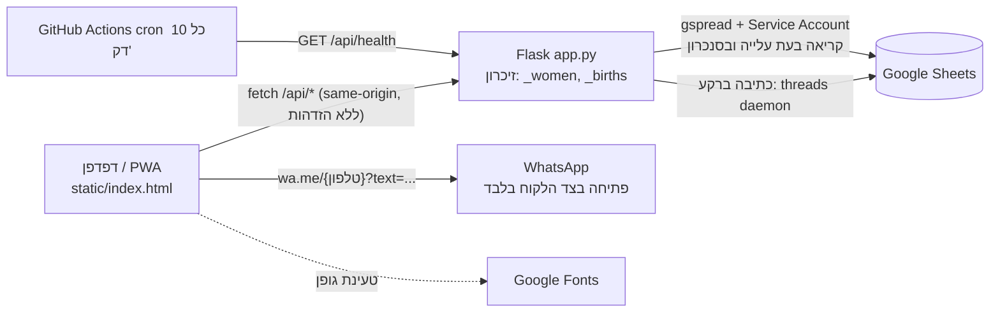

# PROJECT_AUDIT_CONTEXT.md — הקשר לביקורת מקצועית, טכנית ואבטחתית

> מסמך זה נכתב על סמך קריאה בפועל של כל קובצי המאגר `chesed-app` (10 קבצים, כ-1,700 שורות) ושל היסטוריית ה-git (50 קומיטים).
> לא בוצעו שינויים בקבצי הפרויקט, לא בוצעו בדיקות חדירה ולא נעשו פניות למערכות חיצוניות.
> המסמך אינו כולל סיסמאות, מפתחות, פרטי תיקים או נתוני אנשים אמיתיים.

**מקרא רמות ודאות:**
- ✅ **אומת בקוד** — נקרא ישירות, עם נתיב ושורה.
- 🟡 **השערה** — מסקנה סבירה שלא ניתן לאמת מהמאגר לבדו (תצורת פריסה, התנהגות ספריות, תוכן הגיליון החיצוני).
- ❌ **לא נמצא** — חיפשתי ולא מצאתי; אין להניח שקיים.

---

## 0. אזהרה מקדימה: אי-התאמה בין הבריף לקוד שנבדק (קריטי ל-GPT-6)

הבריף מתאר "פרויקט עבור בית הדין הרבני" עם חיבורי שיר"ה, ספרא ושירותי AI.
**המאגר שנבדק אינו מערכת כזו.** ✅

| טענה בבריף | מה נמצא בפועל |
|---|---|
| מערכת לבית הדין הרבני | ❌ לא נמצא. הקוד הוא אפליקציית ווב לתיאום בישולים וסיוע הדדי של גרעין תורני קהילתי ברמלה (`app.py:2`, `static/manifest.json:2-4`). |
| אינטגרציית שיר"ה | ❌ לא נמצא. חיפוש טקסט בכל המאגר: אפס התאמות. |
| אינטגרציית ספרא | ❌ לא נמצא. |
| שירותי AI (LLM) | ❌ לא נמצא. אין ספריית AI ב-`requirements.txt` ואין קריאות כאלה בקוד. |
| תיקים, פסקי דין, מסמכים | ❌ לא נמצא. הישויות היחידות הן: רשימת משפחות מתנדבות, אירועי לידה וצוותי בישול. |

הערות על מקור הבלבול האפשרי:
- שם הענף הנוכחי (`claude/rabbinical-court-project-audit-...`) כולל "rabbinical-court", אבל אין לו ביטוי בקוד. ✅
- 🟡 ייתכן שהמאגר הנכון לא צורף לסשן. יש לוודא מול המשתמש לפני העברת המסמך ל-GPT-6.
- **המשך המסמך מתאר אך ורק את מה שקיים בפועל.** סעיפים שמבוססים על דרישות הבריף (שיר"ה, ספרא, AI) מסומנים "לא נמצא".

---

## 1. מטרת הפרויקט

✅ **מה זה:** מערכת ניהול "סבב חסד" לגרעין תורני (עמיחי רמלה). היא מסייעת לתאם צוותי מתנדבות שמבשלות למשפחות לאחר לידה (`app.py:2`, `static/manifest.json:2-4`, `static/index.html:592-593`).

**למי מיועדת:** מתאמת/מתאמות של הגרעין. הממשק הוא PWA בעברית ו-RTL (`static/manifest.json:10-11`), נראה שמיועד לנייד. 🟡 מספר המשתמשים בפועל לא ידוע.

**פעולות שהמערכת מייעלת:**
1. טעינת רשימת משפחות מתנדבות מגיליון Google Sheets קיים (`app.py:335-376`).
2. הצעת צוות מתנדבות לפי "מי בישלה הכי מזמן", עם עדיפות לאותה שכונה (`app.py:634-666`).
3. רישום אירוע לידה ושיוך צוות בישול (`app.py:504-542`).
4. הפקת הודעות WhatsApp מוכנות: בקשה, תזכורת, הודעה חופשית (`static/index.html:574-633`).
5. עזר לפתיחת קבוצת WhatsApp ושמירת קישור ההזמנה (`index.html:638-667`, `app.py:590-600`).
6. טיפול בהחלפת מתנדבת ובסימון "לא זמינה" לתקופה (`app.py:484-495`, `562-588`).
7. רישום סיום תקופת הבישול בגיליון ההיסטוריה המקורי (`app.py:159-186`).

---

## 2. ארכיטקטורה

### 2.1 טכנולוגיות (✅ מ-`requirements.txt` ומהקוד)
| רכיב | פרט |
|---|---|
| שפה/שרת | Python 3, Flask 3.0.3, Flask-CORS 4.0.1, gunicorn 22.0.0 |
| הגדרות | python-dotenv 1.0.1 |
| גישה ל-Sheets | gspread 6.1.2, google-auth 2.29.0 (Service Account) |
| לקוח | קובץ HTML יחיד עם JavaScript טהור ו-CSS (אין framework ואין build), `static/index.html` (909 שורות) |
| PWA | `static/manifest.json`, `static/sw.js` |
| גופן | Heebo מ-Google Fonts (`index.html:17`), תלות חיצונית בצד הלקוח |
| תחזוקת "ערנות" | GitHub Actions: `curl` ל-`/api/health` כל 10 דקות (`.github/workflows/keepalive.yml`) |

### 2.2 מסד נתונים
- ❌ **אין מסד נתונים.** המצב החי נשמר בזיכרון התהליך: `_women` ו-`_births` (`app.py:381-394`).
- **שכבת התמדה: גיליון Google Sheets.** לשונית "גיבוי" מכילה JSON סידרתי של הלידות ושל מצבי הסטטוס (`app.py:233-271`).
- 🟡 הערה בקוד (`app.py:190`) מזכירה "Supabase birth_history" כמקור היסטוריה. אין שום שימוש ב-Supabase במאגר, ולכן זה רק תיעוד של מקור נתונים היסטורי שאינו מצוי בקוד.

### 2.3 API (✅ `app.py`)
| נתיב | שיטה | שורות | תפקיד |
|---|---|---|---|
| `/` | GET | 436-438 | מגיש את `index.html` |
| `/api/women` | GET / POST | 443-467 | רשימה / הוספה |
| `/api/women/<id>` | PATCH | 469-482 | עדכון שדות |
| `/api/women/<id>/cant` | POST | 484-495 | "לא זמינה" ל-7 ימים |
| `/api/births` | GET / POST | 500-542 | רשימה / יצירה |
| `/api/births/<id>` | DELETE | 544-560 | מחיקה/סגירה + רישום בגיליון |
| `/api/births/<id>/replace` | POST | 562-588 | הסרת חברת צוות |
| `/api/births/<id>/group` | POST | 590-600 | שמירת קישור קבוצה |
| `/api/births/<id>/add-member` | POST | 602-629 | הוספת חברת צוות |
| `/api/suggest` | GET | 634-666 | הצעת צוות |
| `/api/sync` | POST | 671-682 | טעינה מחדש מה-Sheets |
| `/api/debug-phones` | GET | 684-707 | **ניפוי שגיאות, חשוף בפרודקשן** |
| `/api/health` | GET | 709-720 | בדיקת חיים |

### 2.4 תרשים זרימת מידע

לשוניות בגיליון שהקוד קורא או כותב (שמות כפי שמופיעים בקוד):
- קריאה: רשימת משפחות הגרעין (`app.py:341`), דף קשר גרעין (299), תאריך בישול אחרון (280, **הפונקציה `load_cooking_history` מוגדרת ואינה נקראת באף מקום** ✅).
- כתיבה: נשים (147), גיבוי (239), שיבוץ מבשלות חדש (174, 200).
- יצירה אוטומטית אם חסרות: נשים, לידות, גיבוי (`app.py:125-130`). 🟡 לשונית "לידות" נוצרת ואינה בשימוש בקוד ✅ (אין התייחסות אליה מלבד היצירה).

---

## 3. מבנה הקוד

```
chesed-app/
├── app.py                      725 שורות — כל ה-backend
├── requirements.txt            6 תלויות מקובעות
├── README.md                   ריק (0 שורות)
├── .gitignore                  __pycache__/, *.pyc, .env
├── .github/workflows/keepalive.yml   פינג כל 10 דקות לשירות בפרודקשן
└── static/
    ├── index.html              909 שורות — כל ה-UI, CSS ו-JS
    ├── sw.js                   23 שורות — Service Worker
    ├── manifest.json           17 שורות
    └── icons/icon-192.png, icon-512.png
```

**נקודות כניסה:**
- שרת: `python app.py` (`app.py:723-725`; פורט מ-`PORT`, ברירת מחדל 5050) או gunicorn. ❌ אין `Procfile`/`Dockerfile`/`render.yaml` במאגר; פקודת ההפעלה בפרודקשן אינה ידועה. 🟡 הכתובת `chesed-app.onrender.com` ב-`keepalive.yml` ו-commit בשם "keep Render service awake" מצביעים על Render.
- קוד ברמת מודול רץ **בעת import**: טעינת Sheets, העשרת טלפונים, שחזור גיבוי והזרמת backfill (`app.py:397-406`). כל עלייה של worker מבצעת קריאות רשת וכתיבות.
- לקוח: `index.html` נטען מ-`/` ומשוחזר דרך ה-Service Worker (`index.html:904-905`).

**מבנה `app.py` (אזורי אחריות):** מיפוי רחובות לשכונות (29-95) · שכבת Sheets (97-376) · נתוני זיכרון (378-431) · נתיבים (433-720).

---

## 4. אינטגרציות

| אינטגרציה | סטטוס | פרט |
|---|---|---|
| **Google Sheets** | ✅ קיימת | Service Account דרך `GOOGLE_SERVICE_ACCOUNT_JSON`, מזהה גיליון דרך `GOOGLE_SHEET_ID` (`app.py:100-136`). ה-scope כולל `drive` מלא (118-119), רחב מהנדרש. |
| **WhatsApp** | ✅ בצד לקוח בלבד | `window.open('https://wa.me/<מספר>?text=...')` (`index.html:580, 655, 799`). אין WhatsApp Business API, אין שליחה אוטומטית מהשרת. כל שליחה דורשת לחיצה אנושית. |
| **שיר"ה** | ❌ לא נמצא | |
| **ספרא** | ❌ לא נמצא | |
| **שירותי AI / LLM** | ❌ לא נמצא | |
| **Supabase** | ❌ לא נמצא בקוד | מוזכר רק בהערה (`app.py:190`). |
| **Google Fonts** | ✅ | `index.html:17` |
| **GitHub Actions → פרודקשן** | ✅ | `keepalive.yml:5-13` |

---

## 5. אבטחת מידע

### 5.1 הזדהות והרשאות
- ❌ **אין הזדהות ואין הרשאות.** חיפוש `login|password|token|auth` ב-`app.py` וב-`index.html` מצא רק התייחסויות ל-gspread. כל נקודות הקצה, כולל כתיבה ומחיקה, פתוחות לכל מי שמכיר את הכתובת. ✅
- `CORS(app)` ללא הגבלת מקורות (`app.py:26`) ✅.
- אין rate limiting, CSRF או לוג ביקורת (audit log) על שינויים. ✅

### 5.2 הצפנה ותקשורת
- 🔴 **כיבוי אימות TLS גלובלי:** `ssl._create_default_https_context = ssl._create_unverified_context`, `urllib3.disable_warnings()` ו-monkey-patch ל-`requests.Session.request` שמגדיר `verify=False` כברירת מחדל (`app.py:11-21`). ההערה בקוד מציינת "BlueCoat SSL bypass" — כלומר פתרון שנועד לסביבת רשת עם proxy ארגוני. הוא פעיל גם בפרודקשן ללא תנאי. כל התקשורת עם Google, כולל החלפת אסימוני Service Account, חשופה ל-MITM. ✅
- הצפנה במנוחה: ❌ אין. הנתונים הם JSON גולמי בתאי גיליון. 🟡 ההגנה על הגיליון תלויה בהרשאות Google של הבעלים.

### 5.3 טיפול בסודות
- ✅ הסודות נטענים ממשתני סביבה; `.env` מופיע ב-`.gitignore`.
- 🔴 `/api/health` ציבורי ומחזיר `sa_json_len` ו-**`sa_json_start`** — 10 התווים הראשונים של JSON ה-Service Account (`app.py:709-720`, במיוחד 717-718). זה דליפה חלקית של סוד לכל אחד. בפועל התווים הראשונים הם בדרך כלל מבנה קבוע (`{"type":...`), ולכן הסיכון המעשי נמוך, אך הדפוס שגוי ויש לבטל אותו. ✅ (הערכת הסיכון המעשי: 🟡)
- לא נמצאו סודות בקוד המקור בבדיקה שלי של הקבצים. 🟡 לא בוצעה סריקה מלאה של היסטוריית git לסודות; מומלץ להריץ gitleaks/trufflehog.

### 5.4 מידע אישי בקוד ובלוגים
- 🔴 **פרטים אישיים אמיתיים מקודדים במקור ונמצאים ב-git:** `backfill_cooking_log_once` מכילה 19 שורות עם שמות, מספרי טלפון וקשרי בישול (`app.py:203-223`). בנוסף, `_women` מכיל נתוני דמה בשורות 381-392 (🟡 נראים פיקטיביים). פרטי הדוגמה האמיתיים נשארים בהיסטוריה גם אם יימחקו מהקובץ. ✅
- 🟡 הלוגים (`print`) כוללים הודעות שגיאה של gspread. לא נבדק אם הן כוללות נתונים אישיים.
- `/api/women` ו-`/api/births` מחזירים טלפונים וכתובות מגורים לכל מי שפונה. ✅

### 5.5 XSS בצד לקוח
- 🔴 מחרוזות מהשרת (שמות, שכונות, כתובות) נכנסות ל-`innerHTML` ללא escaping, למשל ב-`index.html:431, 481, 526, 535-536, 604-606, 621-623, 676, 757, 815, 865`. כיוון ש-`POST /api/women` פתוח (`app.py:449-467`) ושדות הגיליון נקראים כמות שהם, אפשר להחדיר HTML/JS שיורצו אצל כל משתמש (Stored XSS). ✅
- 🔴 `groupLink` נשמר ללא ולידציה (`app.py:598`) ומוזרק ל-`onclick="window.open('${b.groupLink}'...)"` (`index.html:616`). ערך עם גרש ניתן לשבור את ה-attribute ולהריץ קוד, וערך `javascript:` אפשרי. ✅
- שם מתנדבת מוזרק ל-`onclick` עם escape של גרש בלבד (`index.html:606`); לא נבדק מול מקרי קצה נוספים (🟡).
- Service Worker: `respondWith(fetch ... put(cache))` מאחסן כל תגובה, כולל קבצים לא-HTML, וחוזר למטמון רק בכשל רשת (`sw.js:15-22`) ✅. נתיבי `/api/` מוחרגים, כך שנתוני API אינם נשמרים במטמון ✅.

---

## 6. פעולות אוטומטיות ובקרות

**פעולות שהמערכת מבצעת ללא אישור משתמש בזמן אמת:**
| פעולה | מקור | הערה |
|---|---|---|
| החזרה אוטומטית ל"זמינה" כשפג תוקף אי-זמינות | `app.py:408-431` (נקראת מ-`get_women` ו-`suggest_team`) | פעילה כשמישהו קורא ל-API, אין job ברקע |
| כתיבה מלאה ל-Sheets אחרי כל שינוי | `sync_to_sheets_bg`, `save_app_data_bg` (`app.py:138, 230`) | threads daemon, ללא תור וללא ניסיון חוזר |
| מחיקת תוכן לשונית "נשים" וכתיבתו מחדש | `app.py:148` | `ws.clear()` ואז `append_row` לכל שורה |
| מחיקת תוכן לשונית "גיבוי" וכתיבתו מחדש | `app.py:240` | |
| השלמת טלפונים חסרים לפי התאמת שמות | `app.py:293-333` | התאמה לפי חפיפת ≥2 מילים, או מילה בודדת לשם בן מילה אחת |
| רישום שורות בגיליון ההיסטוריה בסיום תקופה | `app.py:159-186` | הוספה בלבד (append) |
| Backfill חד-פעמי | `app.py:188-228` | מותנה ב-`col_values(1) > 977` — ערך קסם קשיח |
| סימון יולדת כ"ילדה" ובשאר משתתפות כ"מבשלות" | `app.py:513-521` | זיהוי יולדת לפי **שם מדויק** |

**פעולות שדורשות אישור/פעולה אנושית:**
- שליחת הודעות WhatsApp: ✅ תמיד לחיצה ופתיחת `wa.me`, אין שליחה אוטומטית.
- מחיקת לידה: `confirm()` בצד לקוח בלבד (`index.html:779`). מעקף אפשרי דרך ה-API ללא בקרה. ✅
- שמירת קישור קבוצה: `prompt()` (`index.html:659`).

**מנגנוני מניעת טעויות שנמצאו:** ולידציה של שדות חובה ב-`POST /api/women` ו-`POST /api/births` (`app.py:453, 508-511`); הוצאת מתנדבות שבישלו מההצעות (`app.py:653-655`); גיבוי מצב לגיליון; תיקון ידוע בהשוואת `unavailUntil` (`app.py:408-423`). **אין:** אימות סכימה, סינון שדות מעבר ל-`allowed` ב-PATCH (קיים, שורה 476), נעילות או גרסאות אופטימיסטיות.

---

## 7. בעיות ידועות ומגבלות

מקורות: הערות בקוד והיסטוריית קומיטים (✅), ומסקנות שלי (🟡).

1. ✅ **תיקונים קודמים שמעידים על שבריריות:** אובדן נתונים בסנכרון ידני (`06a64dd`), שגיאת 500 ב-`restoreAvailable` (`452ddda`), קריסת `GET /api/women` בגלל השוואת טיפוסים (תיעוד ב-`app.py:408-423`), מטמון ישן של ה-Service Worker (`b516aa7`).
2. ✅ **טעינה איטית של השרת.** הערה בשורות 104-109 וקומיט `7686d03`: ה"ערנות" מבוצעת בפינג חיצוני. 🟡 זה מרמז על Free tier שנרדם.
3. ✅ **README ריק.** אין תיעוד הפעלה, פריסה, או סכימת הגיליון.
4. ✅ **תלות בסכימת גיליון לא מתועדת.** האינדקסים של העמודות קשיחים (`row[0]`, `row[1]`, `row[4..6]`, `row[8]`, `app.py:349-354`; עמודה 3 ב-`300-305`). שינוי עמודות בגיליון ישבש את הנתונים בשקט.
5. ✅ **קוד שאינו בשימוש:** `load_cooking_history` (273-291), וכנראה גם `sendWhatsApp` (`index.html:788-801`) 🟡 (לא נבדק אם נקראת מה-HTML).
6. ✅ **שדה `closed` נבדק בלקוח** (`index.html:671, 694`) אבל השרת אינו מגדיר אותו אי פעם. `DELETE` מוחק את הלידה. ההערה "delete or archive" בקוד (164) אינה תואמת למימוש ✅.
7. ✅ **ה-ID של לידה הוא `int(time.time()*1000)`** (`app.py:529`): התנגשות אפשרית בשתי יצירות באותה אלפית שנייה (🟡 הסתברות נמוכה).
8. ✅ **מזהי מתנדבות נוצרים מחדש בכל סנכרון** (`wid` רץ מ-1, `app.py:347-372`), ולכן סדר שורות שונה בגיליון משנה מזהים. הגיבוי שומר סטטוסים לפי `id` (244, 265), ולכן שינוי בגיליון עלול להצמיד סטטוס לאדם הלא נכון. 🟡 תלוי בהרגלי עריכת הגיליון.
9. ✅ **`DELETE` של לידה שאינה קיימת מחזיר `ok: true`** (`app.py:544-560`).
10. ✅ **`replace_team_member`** מחזיר 500 אם `days` אינו מספר (`int(...)` ללא try, שורה 572).

---

## 8. סיכונים אפשריים

### 8.1 אבטחה (לפי חומרה משוערת)
| # | סיכון | מיקום | רמה |
|---|---|---|---|
| S1 | API ללא הזדהות: קריאה, יצירה ומחיקה של נתוני אנשים לכל מי שמגלה את הכתובת | `app.py:443-720` | ✅ גבוה |
| S2 | אימות TLS כבוי גלובלית | `app.py:11-21` | ✅ גבוה |
| S3 | Stored XSS דרך שמות, כתובות וקישור קבוצה | `index.html:604-623, 616`; `app.py:449-467, 598` | ✅ גבוה |
| S4 | נקודת `debug-phones` חושפת שמות ושורות מדגם מדף הקשר | `app.py:684-707` | ✅ גבוה |
| S5 | `/api/health` חושף חלק מה-Service Account JSON | `app.py:717-718` | ✅ בינוני (מעשית 🟡 נמוך) |
| S6 | נתונים אישיים אמיתיים בקוד ובהיסטוריית git | `app.py:203-223` | ✅ בינוני-גבוה (תלוי בנראות המאגר, 🟡 לא ידועה) |
| S7 | Service Account עם scope `drive` מלא | `app.py:118-119` | ✅ בינוני |
| S8 | `debug=` נשלט משתנה סביבה `FLASK_DEBUG`; אם יופעל בפרודקשן, Werkzeug debugger מאפשר הרצת קוד | `app.py:725` | 🟡 תלוי תצורה |
| S9 | CORS פתוח לכל מקור | `app.py:26` | ✅ בינוני |
| S10 | אין rate limiting; ה-endpoints `sync`/`debug-phones` יוצרים קריאות ל-Google ללא הגבלה | | ✅ נמוך-בינוני |

### 8.2 אובדן ושיבוש נתונים
- ✅ **כתיבות לא אטומיות:** `ws.clear()` ואז `append_row` שורה-שורה (`app.py:148-155, 240-246`). קריסה או הגבלת קצב של Google באמצע משאירה לשונית חלקית. ובשל העובדה שה"גיבוי" היא נקודת השחזור היחידה (מקור `load_app_data`), עלולה לשבש גם את המצב.
- ✅ **Race בין threads:** כל שינוי פותח thread שכותב את כל המצב. שני שינויים סמוכים ממיינים כתיבות חופפות על אותה לשונית, וה-`ws.clear()` של אחד עלול למחוק את התוצאה של השני. אין נעילה.
- 🟡 **תקרות Google Sheets:** תא יחיד מוגבל ל-50,000 תווים. JSON הלידות כולו נכתב לתא אחד (`app.py:242`). עם הצטברות היסטוריה הוא עלול לחרוג ולהיכשל בשקט (השגיאה רק נדפסת).
- 🟡 **מגבלת קצב API של Google** (~60 כתיבות/דקה למשתמש): `sync_to_sheets` מבצע קריאה לכל מתנדבת, ולכן ברשימה גדולה (מאות) הוא צפוי להיתקל במגבלה.
- ✅ **מצב בזיכרון:** כל תהליך מחזיק עותק משלו. 🟡 אם gunicorn מופעל עם יותר מ-worker אחד, המצבים יתפצלו וכל worker ידרוס את הגיבוי של האחר.
- ✅ **מחיקת לידה כוללת הסרה מההיסטוריה.** הרישום בגיליון נעשה רק אם `team` לא ריק (`app.py:167-169`), ולכן לידה בלי צוות נעלמת ללא עקבות.
- ✅ **שמירה לפי שם:** זיהוי היולדת (`app.py:514, 555`) לפי שוויון מחרוזת. שמות כפולים או שינוי איות יסמנו אדם שגוי או לא יחזירו סטטוס.
- ✅ **`log_cooking_completion` מתבצע בכל DELETE, גם של לידה שנרשמה בטעות.** התוצאה: שורות היסטוריה שגויות שמשפיעות על חישובי "מי בישלה לאחרונה" בגיליון.
- ✅ **Backfill:** תנאי הריצה "מספר שורות > 977" (`app.py:201`) רגיש להוספה ידנית של שורות לגיליון (יידלג) או למחיקתן (ירוץ שוב ויכפיל שורות).

### 8.3 טעויות אוטומציה
- ✅ התאמת טלפונים לפי חפיפת שמות (`app.py:317-330`) עלולה לשייך מספר לאדם הלא נכון; ההודעות נשלחות לפי המספר הזה.
- ✅ הודעות WhatsApp כוללות כתובת וטלפון של משפחה (`index.html:593`) ונשלחות למספר שנקבע לפי ההתאמה האוטומטית. 🟡 סיכון פרטיות אם המספר שגוי.
- ✅ המרת מספר: `replace(/^0/,'972')` (`index.html:578`) מניחה מספר ישראלי; קלט עם קידומת בינלאומית יישבר.

### 8.4 כשלים תפעוליים
- ✅ נקודת כשל יחידה: שרת אחד, גיליון אחד, אין ניטור ואין התראות.
- ✅ אין מנגנון גיבוי חיצוני מעבר ללשונית באותו גיליון, כך שמחיקה בטעות של הגיליון מאבדת הכל.
- ✅ הפינג התקופתי מצריך שמשתמשים בפרודקשן יישארו ללא הפסקה על שירות חינמי (🟡) ויוצר תלות ב-GitHub Actions (אין התחייבות שמירת cron).
- ✅ קוד פועל בזמן import (`app.py:397-406`): תקלת רשת בעלייה = השרת עולה עם נתוני הדמה (`app.py:381-392`) ויציג אותם כאמיתיים. ✅ אין סימון חזותי לכך.

---

## 9. בדיקות קיימות

- ❌ **אין בדיקות אוטומטיות.** אין תיקיית `tests`, אין pytest/unittest, אין CI של בדיקות. ה-workflow היחיד הוא ה-keepalive. ✅
- ❌ אין Lint/טיפוסים/Type checking.
- ❌ אין תיעוד לבדיקות ידניות. 🟡 ההיסטוריה (קומיטי "Fix ...") מרמזת שהבדיקה נעשית ידנית בפרודקשן.
- ❌ לא הורצו בדיקות ולא הופעל השרת בשלב זה (לפי ההוראה).

**חסר, לפי עדיפות:** בדיקות יחידה ל-`_unavail_expired`, `detect_hood`, `enrich_phones_from_contact_tab`, `suggest_team`; בדיקות API עם Sheets מדומה (mock); בדיקות XSS/ולידציה; בדיקת שחזור מצב מ"גיבוי"; בדיקת התנהגות תחת מקביליות.

---

## 10. המלצות לשיפור

### אבטחה (עדיפות 1)
1. הוספת הזדהות לכל `/api/*` (לפחות סיסמה/קוד גישה משותף מאחורי session, ועדיף כניסה לפי משתמש) והרשאות לפעולות כתיבה ומחיקה.
2. הסרת `ssl._create_unverified_context`, `verify=False` ו-`disable_warnings`. אם נדרש proxy ארגוני, להגדיר `REQUESTS_CA_BUNDLE`/CA ייעודי רק בסביבה הרלוונטית.
3. מחיקת `/api/debug-phones`; צמצום `/api/health` ל-`{"status":"ok"}` בלבד.
4. Escaping בצד לקוח: מעבר ל-`textContent`/פונקציית `esc()` לכל נתון; הימנעות מ-`onclick` מוטבע עם נתונים; ולידציית `groupLink` לפי `https://chat.whatsapp.com/`.
5. הגבלת CORS לאותו מקור, הגבלת scope של ה-Service Account ל-`spreadsheets` בלבד, והגבלת הגישה לגיליון הספציפי.
6. הסרת פרטים אישיים מהקוד (backfill), והחלטה על ניקוי היסטוריית git; סריקת סודות מלאה.
7. הוספת כותרות אבטחה (CSP, X-Content-Type-Options) ו-rate limiting.

### אמינות ונתונים
8. מעבר מזיכרון+גיליון למסד נתונים אמיתי (SQLite/Postgres) כמקור אמת, עם Sheets כייצוא/ייבוא בלבד.
9. עד אז: כתיבה אטומית (`ws.update` בטווח אחד במקום `clear`+`append_row`), נעילה סביב כתיבות, תור כתיבה אחד, וניסיון חוזר עם backoff.
10. מזהים יציבים (UUID, או מזהה בגיליון) במקום אינדקס שורה, וזיהוי יולדת לפי `id` ולא לפי שם.
11. הפרדת "מחיקה" מ"סגירה/ארכוב" (שדה `closed` או `status`) ו-log ביקורת (מי שינה מה ומתי).
12. התאמת טלפונים: הצגת "הצעות" לאישור אנושי במקום החלה אוטומטית.
13. הסרת לוגיקת הרצה בזמן import ל-`create_app()`/hook אתחול; סימון ברור כשהמערכת רצה על נתוני דמה.

### ביצועים
14. שמירת Sheets client כבר קיימת (`app.py:112`). מומלץ להוסיף batch writes ו-cache עם TTL לקריאות.
15. תוכנית מתאימה לשרת שאינו נרדם, או הפחתת התלות בפינג.

### תחזוקה
16. פיצול `app.py` ל-modules (config / sheets / routes / models) ו-`index.html` לקבצי JS/CSS נפרדים.
17. README: הפעלה, משתני סביבה, סכימת הגיליון, פריסה; `Procfile`/הגדרת gunicorn עם worker אחד מתועד.
18. הוספת pytest, GitHub Action לבדיקות ו-`pip-audit`/Dependabot.
19. הסרת קוד מת (`load_cooking_history`, `backfill_cooking_log_once` לאחר אישור).

### חוויית משתמש
20. הודעות שגיאה ברורות לכשלי סנכרון (כיום רק `print` בשרת, והמשתמש לא רואה כשהכתיבה נכשלה).
21. אישור מחיקה בצד שרת ו"ביטול פעולה" (undo).
22. 🟡 בדיקת נגישות (ניגודיות, גודל מגע) — לא נבדק בפועל.

---

## נספח א: מה לבדוק מול המשתמש לפני ביקורת ב-GPT-6

1. האם זהו המאגר הנכון? הבריף מתאר מערכת בית דין עם שיר"ה/ספרא/AI, והמאגר הזה אינו כזה.
2. אם כן: האם המטרה לבקר את אפליקציית הגרעין? אז מסמך זה מכסה את הקיים.
3. אם לא: יש לצרף את המאגר המתאים, ולהריץ מחדש את הסקירה.
4. איפה מופעל השירות (פקודת הפעלה, מספר workers, משתני סביבה בפועל)? אינו נראה במאגר.
5. מי יכול לגשת לכתובת הציבורית ולגיליון, והאם המאגר ב-GitHub פרטי?

## נספח ב: שיטת הבדיקה
קריאה מלאה של `app.py`, `sw.js`, `manifest.json`, `keepalive.yml`, `requirements.txt`, וקריאה ממוקדת של `index.html` (חלקי API, WhatsApp, רינדור). חיפושי טקסט (`grep`) בכל המאגר למילים: שיר"ה, ספרא, AI/OpenAI/Anthropic/GPT, login/password/token/auth, supabase, innerHTML, localStorage. סקירת `git log` (50 קומיטים). לא הופעל השרת ולא בוצעה פנייה לרשת.
